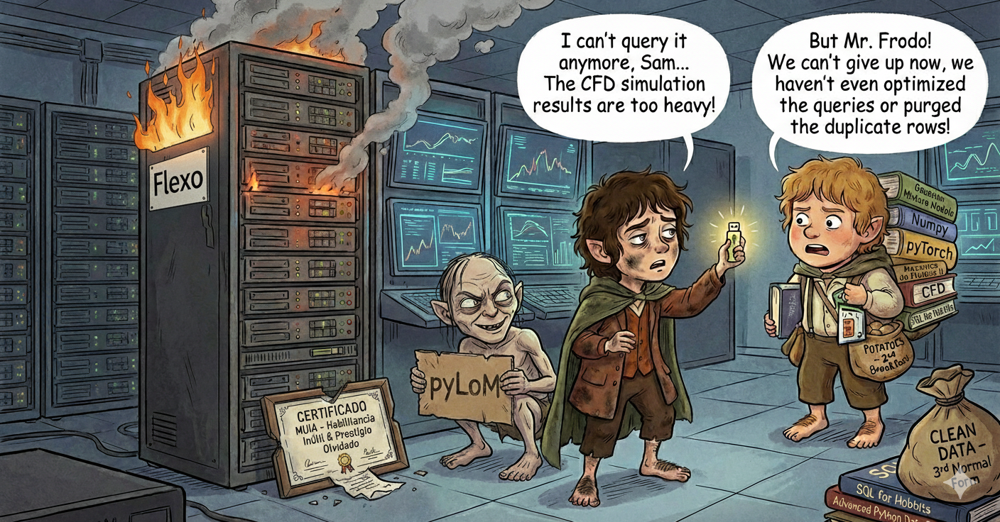

# Fellowship of the Ring

## Intro y los panas

Buenos días.

Si estás por aquí es que vienes a conocer una de las más grandes obras de la literatura, cine y cultura humana que ha existido jamás. Vienes a conocer a la Comunidad del Anillo, ese grupo de héroes y personajes cuya misión es devolver el Anillo Único a su lugar de creación para destruirlo, y así frustar la vuelta del Señor Oscuro, Sauron.

Sin más dilación, y currándome esto menos de lo que debería, vamos a introducir a los personajes principales:
- FRODO (Framework for Reusable Organized Data Output): Es el personaje principal de nuestro grupo y se dedica a manejar la base de datos (el anillo que nadie quiere pero te da toda la información) para que la moldeemos a nuestro gusto. Podemos calcular variables internas, elegir parámetros y organizar los datos.

- SAM (Simulations & Analytics Module): Como en los personajes originales, FRODO se lleva el mérito sin llevar la mochila de los juguetes que nos salvan la vida. SAM lleva ahora y siempre esa mochila donde tenemos las herramientas principales de cálculo y distribución. Cuando FRODO se ralle la cabeza con diccionarios más largos que una clase de Certi y operaciones dignas de un examen de Aerodinámica, habrá un rayo de esperanza, un abrazo consolador, un héroe sin capa que nos sostiene. Ese héroe es SAM.

- SMEAGOL: Jodido pero necesario de tragar, SMEAGOL (pyLOM en el fondo) es un personaje que nos muestra caminos que no nos gustan con formas y comportamientos que no nos dan buena espina, pero que en el fondo funcionan. ¿Tienes que llevarle contigo? Si. ¿Debes fiarte de él? Nunca. ¿Es complicado de manejar? Hasta para pedir la hora. ¿Puede que te traicione de vez en cuando? Tenlo por seguro. Es lo que hay.

- GIMLI: 

- LEGOLAS (Lightweight Exploratory Graphics Of Loaded Aerodynamic Simulations): En todo grupo de amigos de aventuras siempre hay alguien guapo que nos deja en segundo plano. Alguien que libra todas sus batallas con un glamur y una elegancia que no sabes si es admiración o envidia lo que sientes. Alguien que no se le mueve un pelo de su impresionante imagen a pesar de que llevéis 11 horas luchando contra orcos. Y no por eso se le tiene que dejar de querer a nuestro elfo favorito, a nuestro Orlando Bloom, a nuestro lanzaflechas infinito, a nuestro Légolas. Él nos va a ayudar a darle un poco de color y vida a los datos que manejamos en la Comunidad, aportando sus ojos e imagen para dislumbrar problemas en la más absoluta oscuridad.

- EarendilsLight (o la Luz de Earendil): (En desarrollo) No es un personaje como tal, sino una herramienta de la que disponemos como nuevos integrantes de la Comunidad del Anillo. Nos muestra algo de luz cuando el ambiente está más negro que el sobaco de un grillo. Te mostrará y recordará las funciones y entradas principales de los métodos de los personajes (aunque de momento va a pilas y no funciona muy bien, tiene que seguir mejorando).

- GANDALF: Todo buen grupo tiene alguien que lo forma y lo dirige en sus comienzos. Y ese alguien dirige a los distintos personajes en sus primeros pasos al menos para establecer la misión principal y el rol de cada uno. En nuestro caso, necesitamos una entidad del mundo que transcienda a las demás criaturas, alguien que organice las carpetas de simulaciones, los parámetros a elegir y el espacio de diseño que queremos estudiar. Y tiene que tener un poder especial, ya que será el encargado de enviar los trabajos al cluster. Si vas a empezar una nueva aventura (base de datos), primero habla con Gandalf.

No dudes en escribirme si tienes dudas sobre la convivencia en esta comunidad (miguel.jaraizga@upm.es)

<div align="center">
  
</div>


## Instalación

```bash
pip install -e .
```

Las dependencias del núcleo (numpy, torch, pandas, scipy, matplotlib, meshio,
pyvista, h5py) se instalan solas. `requirements.txt` añade las de visualización
interactiva y utilidades.

> **pyLOM no se instala con el paquete** y no está declarado como dependencia.
> Sin él, el formato `PYLOM` se reporta como no soportado y los métodos de
> exportación a pyLOM de `CODASets` fallan al llamarlos. El resto de CODA y
> NUMPY funciona con normalidad. Si lo necesitas, instálalo aparte.

## Qué cuesta importar esto

Nada, a propósito. Cada personaje y cada formato se cargan la primera vez que
los nombras, y las librerías pesadas la primera vez que alguien las usa de
verdad:

| | |
|---|---:|
| `import FotR` | 3 ms |
| `from FotR import FRODO` | 292 ms |
| Flujo CODA completo (abrir, extraer, estadísticos) | 1,6 s |

Un flujo CODA no llega a cargar `torch`, `seaborn`, `scikit-learn` ni
`plotly` en ningún momento. Antes de la limpieza del 10/10/2026, `import FotR`
costaba 3362 ms porque cargaba los seis personajes, los cinco readers y toda
esa pila.

El mecanismo está en [`FotR/_lazy.py`](FotR/_lazy.py). **Si añades código
pesado**, hay tres reglas: usa `lazy_module('libreria')` a nivel de módulo en
vez de `import libreria`; un `from libreria import Nombre` no se puede diferir
así, ponlo dentro de la función que lo use; y si una anotación menciona una
librería diferida, el módulo necesita `from __future__ import annotations`.

## Formatos soportados

FRODO monta cuatro piezas por formato; no todos los formatos las tienen todas.

| formato | reader | sets | stats | residuals | kwarg obligatorio |
|---|:---:|:---:|:---:|:---:|---|
| `CODA` | ✓ | ✓ | ✓ | ✓ | — |
| `CODA_SINGLE` | ✓ | ✓ | ✓ | ✓ | — (una malla por caso) |
| `NUMPY` | ✓ | ✓ | ✓ | — | `file=` |
| `NUMPYFILE` | ✓ | ✓ | — | — | `file=` (obsoleto) |
| `PYLOM` | ✓ | ✓ | — | — | `file=` |
| `HORSES3D` | ✓ | — | — | ✓ | — (acepta `strict=`) |

## Arranque mínimo

```python
from FotR import FRODO, SAM

db = FRODO(root_dir='/ruta/a/la/base', format='CODA', name='mi_base')

db.extract_inputs(id_group='3')                  # malla y condiciones de vuelo
db.extract_outputs(id_group='3', stage='all')    # variables de solución

db.summary_data()        # árbol de data_dict
print(db.df_state)       # una fila por caso
```

Casi nada de lo que llames como `db.algo(...)` vive en FRODO: se resuelve por
delegación en `sets`, `reader`, `residuals` o `stats`, **en ese orden**. Por eso
la misma llamada puede tener firma distinta según el formato.

## Documentación

| dónde | qué es |
|---|---|
| `doc/frodo_sam/index.html` | Visor de la documentación (ES/EN). Pestaña **FRODO** con una sub-pestaña por formato y, dentro, una por cada pieza (`reader`, `sets`, `stats`, `residuals`) con sus métodos y ejemplos; pestaña **SAM** con una sub-pestaña por área; más el explorador de `data_dict` y un buscador global |
| `doc/gandalf/index.html` | Visor de la documentación de GANDALF (ES/EN). Pestañas **GANDALF** (la fachada), **Rings** con una sub-pestaña por ring y, dentro, una por cada fase de la campaña, **Backpack** y **Problemas** |
| `doc/frodo_sam/ANALISIS.md` | Análisis de arquitectura y deuda técnica, para quien vaya a tocar el código |
| `doc/HANDOFF.md` | Estado del repositorio entre sesiones de trabajo |
| `examples/` | Notebooks por formato y base de datos |

Los visores usan `fetch`, así que necesitan servidor HTTP — con `file://` fallan
por CORS. **Sirve desde `doc/`, no desde cada subcarpeta**: los dos visores se
enlazan entre sí y, con la raíz puesta en uno de ellos, el enlace cruzado da 404.

```bash
python3 -m http.server -d doc 8000
#   http://localhost:8000/frodo_sam/   → FRODO y SAM
#   http://localhost:8000/gandalf/     → GANDALF y los rings
```

Para regenerar la referencia de métodos tras tocar un docstring:

```bash
python3 doc/frodo_sam/generate_docs.py    # FRODO y SAM
python3 doc/gandalf/generate_docs.py      # GANDALF y los rings
```

El generador lee los cuatro registros (`readers/`, `sets/`, `stats/`,
`residuals/__init__.py`) para construir el mapa formato → pieza, así que un
formato nuevo aparece solo en el visor. Lo único que hay que mantener a mano es
la lista `TARGETS` del generador, `guides.json` (narrativa ES/EN) y
`examples.json` (ejemplos, tomados de `examples/`).
